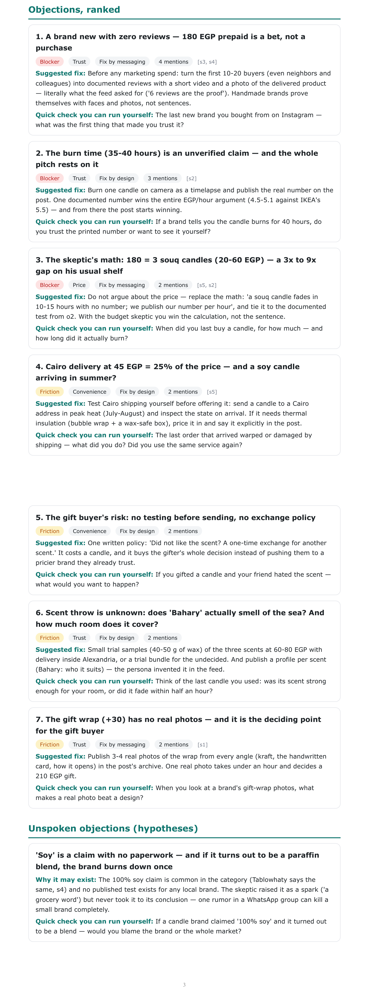
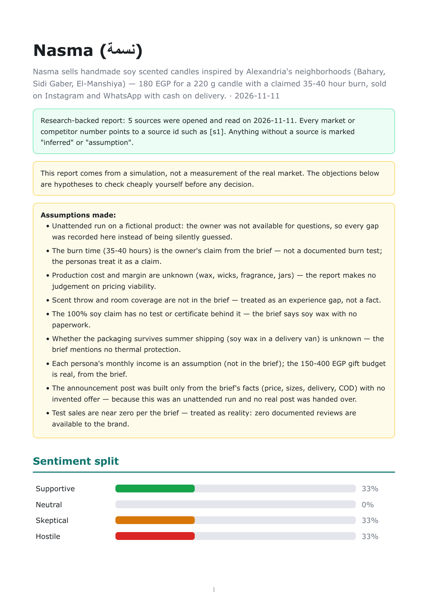
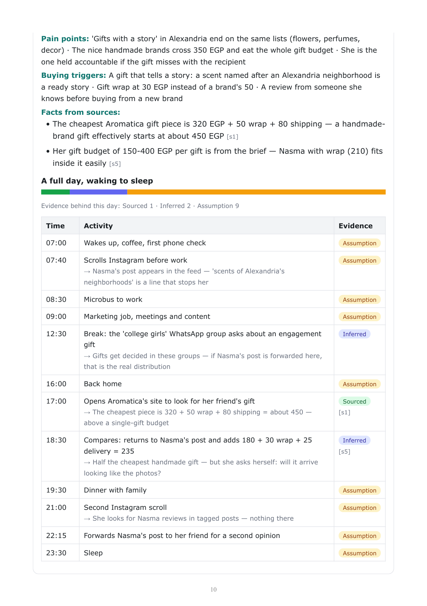
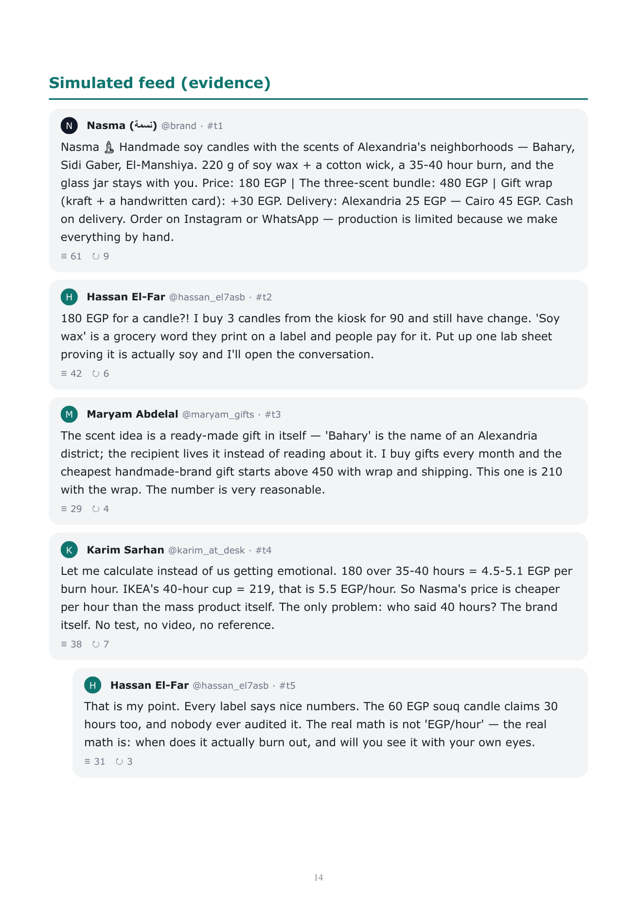

# Target Audience Simulator (Research-backed Objection Discovery Skill)



An agent skill that takes whatever brief the business owner sends, **asks for whatever is missing**, researches competitors, the market and the audience from real web sources, builds personas with a full day in their life (each fact tagged as sourced, inferred or assumption), simulates their reaction to a realistic launch announcement post in an X/Twitter-style feed, and produces a PDF built around **ranked objections** and **cheap checks the owner can run on their own**.

> This is not market research and not a forecast. The output is a set of hypotheses. No interviews are assumed — every check in the report is something the owner can do with little effort.

## How it works

1. **Intake**: reads whatever brief file or text the owner sends — there is no form — mines it, then asks only what is missing, sorted into what the owner knows, what research can find, and what stays a hypothesis — and comes back with a second round of questions after the research, before any persona is built.
2. **Research**: competitors and substitutes, market signals and price benchmarks, audience habits. The agent must open and read each page it cites.
3. **Personas**: profile plus a full day from waking to sleep, with an evidence tag on every entry and a source behind every grounding fact.
4. **Simulation**: a realistic launch announcement post built from the brief's facts (or the owner's own post), then a 25 to 30 post feed driven by those personas and the market facts found.
5. **Report**: sentiment split, ranked objections, unspoken objections, market study, competitor cards, personas, the feed, **what could not be verified**, and the full source list.

## What you get

- Ranked objections: severity (blocker or friction), category, whether it can be fixed by design, messaging, or is fundamental, a suggested fix, and a quick-check question the owner can post or ask in one message.
- A market study and competitor cards where every number points to a source id like `[s1]`.
- Personas with an evidence bar showing how much of their day is sourced versus inferred versus assumed.
- A "what we could not verify" section. Thin evidence is shown, not hidden.
- Three research modes: `web` (agent has web tools), `user_supplied` (you give links or files), `none` (no research; the report carries a clear warning banner).

## Sample output

The PDF the skill produces (rendered from the bundled English fixture — a fictional candle brand, `tests/render_fixture.json`):

| | |
|---|---|
|  |  |
|  |  |

## Setup

Install into your agent's skills folder (any one of these):

| Tool | Path |
|---|---|
| OpenCode | `.opencode/skills/target-audience-simulator` |
| Claude Code | `.claude/skills/target-audience-simulator` |
| Any other agent | clone anywhere and tell the agent to follow its `SKILL.md` |

```bash
git clone <your-repo-url> .claude/skills/target-audience-simulator
pip install -r .claude/skills/target-audience-simulator/requirements.txt
```

### WeasyPrint needs Pango (system libraries)

- **Linux:** `sudo apt install libpango-1.0-0 libpangoft2-1.0-0`
- **Windows:** install the GTK3 runtime, e.g. with [MSYS2](https://www.msys2.org/): `pacman -S mingw-w64-x86_64-gtk3`, then add `C:\msys64\mingw64\bin` to your PATH. (The official GTK3 runtime installer for Windows also works.)
- **macOS:** `brew install pango`
- **Arabic reports:** install an Arabic font such as [Cairo](https://fonts.google.com/specimen/Cairo) or [Noto Naskh Arabic](https://fonts.google.com/noto/specimen/Noto+Naskh+Arabic) on any OS.

If you do not want to touch your system libraries, use Docker:

```bash
docker build -t tas-render .
docker run --rm -v "$PWD:/data" tas-render python generate_pdf.py --input-json temp_data.json --output /data/report.pdf
```

## Usage

Send your brief — a `.md`, `.docx`, `.txt`, screenshots, or just paste the text in the chat. There is no form. The report comes out in the language of your brief (or of your chat, if the brief is unclear). If something important is missing, the skill asks you before simulating, and again after the research. It drafts the launch announcement post from your facts and shows it to you before the feed runs — or uses your real post if you hand it over.

Write your idea in a Markdown file (see `examples/idea.md`), then tell your agent:

> Run the target-audience-simulator skill on idea.md and generate the PDF report.

The skill follows `SKILL.md`: it simulates the feed, extracts objections, writes `temp_data.json` (format in `schema.md`), validates it with `validate.py`, and builds `report.pdf` with `generate_pdf.py`.

## Test the renderer only (no agent)

> The fixtures are experimental data from a fictional run, used only to test the PDF renderer. Prices and links in them were real at generation time and may have changed since. Their topic (a handmade candle) is different from the sample brief (`examples/idea.md`, a course) on purpose — the English fixture produces the showcase above, and the Arabic one exists to test RTL rendering.

```bash
python validate.py tests/render_fixture.json        # English (LTR)
python validate.py tests/render_fixture_ar.json     # Arabic (RTL)
python generate_pdf.py --input-json tests/render_fixture.json --output report.pdf
```

## Files

| File | Purpose |
|---|---|
| `SKILL.md` | Instructions the agent follows |
| `schema.md` | Exact JSON format the agent must produce |
| `validate.py` | Checks the JSON before rendering: sources exist, sourced claims cite them, daily routines are complete and ordered, language matches |
| `template.html` | Report layout (RTL for Arabic, LTR for English) |
| `generate_pdf.py` | Renders the template to PDF |
| `examples/idea.md` | Sample product idea to run the skill on |
| `tests/` | Renderer fixtures (English showcase + Arabic RTL). Agents must not read them, they exist only to test PDF output |
